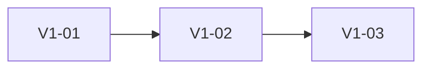

# <VERSION> Roadmap：<PRODUCT-OR-OFFER>

> 本文件是路线图模板，不表示已经接受任何产品范围。实例化时替换占位符、删除本提示，并由用户确认范围。

## 目标

<说明最终交付给谁、解决什么问题，以及可观察的用户成果。>

## 路线原则

- <决定阶段拆分和取舍的稳定原则>；
- <不得为提前结束而删除的已接受范围>；
- <只有满足什么证据才能推进下一阶段>。

## 阶段依赖

下面只演示图示格式，不代表当前项目路线：

实例化后，图中只保留真实工作项或内部 Stage，并在图后用文字说明依赖。顶层工作项使用固定两位编号，例如 `V1-01`、`V1-02`。Roadmap 只表达未来成果、顺序、依赖和完成标志，不写会随执行变化的实时状态或 Stage；这些事实从工作项 README 和 WORK 查询。

## 用户流程

<需要时补充目标流程图；未确认的目标不得写入 Current Framework。>

## 范围

- <已接受的功能或交付物>。

## 非范围

- <明确不属于当前版本的内容>。

## 阶段

### V1-01：<STAGE-NAME>

- `V1-01A`：<内部 Stage 目标>；
- `V1-01B`：<内部 Stage 目标>。

完成标志：<可验证结果>。

## 整体完成标志

- <面向用户或系统的可验证成果>；
- <实现、测试、文档与交接一致性要求>。
